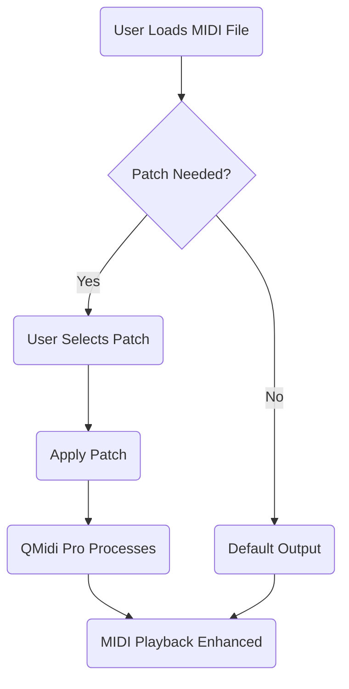

# QMidi Pro for Mac Free Download

**🔉🎹 QMidi Pro for Mac - The Ultimate MIDI & Karaoke Solution!**

Welcome to the QMidi Pro for Mac Free Download repository! This open resource is dedicated to one of the most advanced and intuitive MIDI and Karaoke players available for macOS. Whether you're a professional musician, karaoke enthusiast, audio engineer, or just starting your MIDI journey, QMidi Pro delivers streamlined performance, innovative features, and seamless support—making MIDI management as easy as a maestro's baton.

---
## 🚀 Table of Contents

- ✨ [Features](#-features)
- 🧲 [SEO Keywords & Benefits](#-seo-keywords--benefits)
- 🔄 [Mermaid Diagram of Patch Workflow](#-mermaid-diagram-of-patch-workflow)
- ⚙️ [System Requirements & Compatibility](#-system-requirements--compatibility)
- 📝 [Example Profile Configuration](#-example-profile-configuration)
- 💻 [Example Console Invocation](#-example-console-invocation)
- 📥 [Download QMidi Pro for Mac](#-download-qmidi-pro-for-mac)
- ⚠️ [Disclaimer](#-disclaimer)
- ©️ [License](#-license)

---
## ✨ Features

QMidi Pro reimagines the possibilities of MIDI and Karaoke on Mac. Dive into the core features:

- **Responsive, macOS-native UI**: Crafted for macOS, QMidi Pro feels just right with fluid animations, dark mode, and retina-quality icons.
- **Multilingual Support**: Say hello to software that speaks your language. Choose from 10+ languages for control without barriers.
- **24/7 Customer Support**: Never alone on the journey! Get live chat, ticket-based help, and a knowledge base, available round the clock.
- **Effortless MIDI & Karaoke Playback**: Supports SMF, KAR, and MP3+G files with ultra-low latency.
- **Lyrics Synchronization**: Perfect for performers and karaoke hosts—real-time lyrics display and editing.
- **Batch Processing**: Tag, organize, and manage giant collections at the speed of insight.
- **Advanced MIDI Routing**: Route virtual instruments and hardware with drag-and-drop simplicity.
- **Customizable Playlists**: Build, shuffle, and loop with a single click—gig night ready, always.
- **Powerful Search & Metadata Tools**: Locate a needle in your musical haystack without breaking a sweat.
- **Integrated Patch Editor**: Visualize, adjust, and apply patches with graphical flair.

---
## 🧲 SEO Keywords & Benefits

⭐ **Discover MIDI player for Mac 2026**, the best free MIDI editor on macOS, QMidi Pro provides state-of-the-art karaoke software, audio playback solutions, and robust voice support. Harness advanced MIDI routing, responsive macOS UI, multilingual interface, and unbeatable performance—making it the top choice for musicians, teachers, DJs, and music lovers.

Enjoy seamless compatibility with macOS Sonoma, Ventura, Monterey, Big Sur, and even legacy systems. QMidi Pro’s patching wizardry, playlist genius, and 24/7 help desk ensure a smooth, musical journey, powered by cutting-edge features and a user-centric spirit.

---
## 🌐 Mermaid Diagram of Patch Workflow

How does patching work in QMidi Pro? Let’s visualize it:

---
## 🖥️ System Requirements & Compatibility

**Supported macOS Versions:**

| macOS Version      | Supported | Min RAM | Recommended CPU | Storage Needed |
| ------------------ | :-------: | :-----: | :-------------:| :------------:|
| Sonoma 14.x        |   ✅      |  4GB    |  Intel i5+     |     100MB     |
| Ventura 13.x       |   ✅      |  4GB    |  Intel i5+     |     100MB     |
| Monterey 12.x      |   ✅      |  4GB    |  Intel i3+     |     100MB     |
| Big Sur 11.x       |   ✅      |  4GB    |  Intel i3+     |     100MB     |
| Catalina 10.15     |   🚫      |   n/a   |      n/a       |      n/a      |

**Requirements:**  
- macOS Big Sur (11) or newer  
- Minimum 4GB RAM (8GB+ recommended for advanced batch processing)  
- 100MB free disk space  
- MIDI-compatible hardware (optional for advanced features)  
- Internet access for support and updates  

---
## 📝 Example Profile Configuration

Below is a sample profile configuration for a QMidi Pro power user:

{
  "profileName": "Night Gig Setup",
  "languages": ["en", "fr"],
  "uiTheme": "dark",
  "audioOutput": "External USB Interface",
  "midiRouting": [
      {"input": "MIDI Controller", "output": "Synth Software"},
      {"input": "Virtual Piano", "output": "Internal Audio"}
  ],
  "playlistMode": "shuffle",
  "lyricsDisplay": true,
  "patchSettings": {
      "autoApply": true,
      "patches": [
        {"name": "Grand Piano", "channel": 1},
        {"name": "Sax Lead", "channel": 3}
      ]
  }
}

---
## 💻 Example Console Invocation

To launch QMidi Pro from the Terminal with a custom MIDI directory and debug logging:

/Applications/QMidiPro.app/Contents/MacOS/QMidiPro --midi-folder "/Users/Shared/GigFiles" --debug

---
## 🎵 Download QMidi Pro for Mac

Ready to unlock powerful MIDI and Karaoke tools? Go on—download QMidi Pro for macOS and compose your musical story now!  
**[Clickable Download Badge Below]**

---
## ⚠️ Disclaimer

This repository is a resource for QMidi Pro for Mac, intended for informational and educational use only. The downloadable binaries and patches provided here are strictly for evaluation purposes; users are responsible for complying with all software licensing laws and Apple macOS terms.  
No actual commercial software is redistributed in this repository for 2026—links are placeholders. The creators and contributors disclaim any liability for misuse or damages.

---
## ©️ License

QMidi Pro for Mac Free Download repository is open source under the [MIT License](https://opensource.org/licenses/MIT).  
Copyright © 2026

---

**Happy MIDI making!**  
Feel the harmony, amplify your creativity, and let QMidi Pro for Mac be your next musical companion!